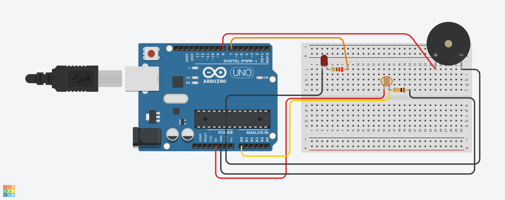

# Arduino LDR Laser Detector

Projeto desenvolvido para a unidade curricular de **Sistemas Embarcados**, do curso de **Análise e Desenvolvimento de Sistemas**, com o objetivo de simular um detector de passagem de objetos utilizando Arduino Uno.

## Sobre o projeto

O projeto consiste em um sistema de detecção de passagem de objetos utilizando um sensor LDR, um buzzer e um LED vermelho, controlados por um Arduino Uno.

O LDR identifica variações na intensidade da luz. Quando a luminosidade fica abaixo de um limite definido no código, o sistema ativa um alerta sonoro por meio do buzzer e um alerta visual por meio do LED vermelho.

A montagem foi desenvolvida e testada no Tinkercad. Como o simulador não disponibilizou o componente laser, a alteração da luminosidade do LDR foi utilizada para simular o bloqueio do feixe de luz.

## Componentes utilizados

- Arduino Uno R3
- Protoboard
- Sensor LDR (fotoresistor)
- Resistor de 10 kΩ
- LED vermelho
- Resistor de 220 Ω
- Buzzer piezoelétrico
- Fios jumper

## Funcionamento

1. O LDR monitora a intensidade da luz.
2. O Arduino lê os valores do sensor.
3. Quando a leitura fica abaixo do limite configurado, o buzzer toca e o LED vermelho acende.
4. Quando a luminosidade volta ao nível esperado, o buzzer para e o LED apaga.

## Simulação

A simulação foi realizada no Tinkercad. O funcionamento foi testado utilizando a alteração da luminosidade do LDR para simular a passagem de um objeto e o bloqueio do feixe de luz.
